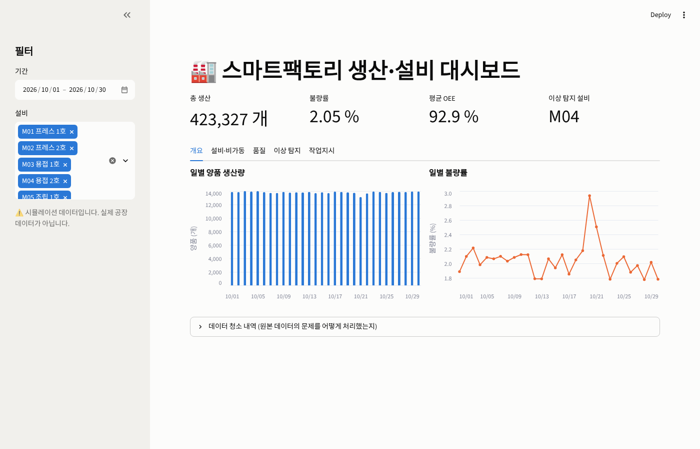
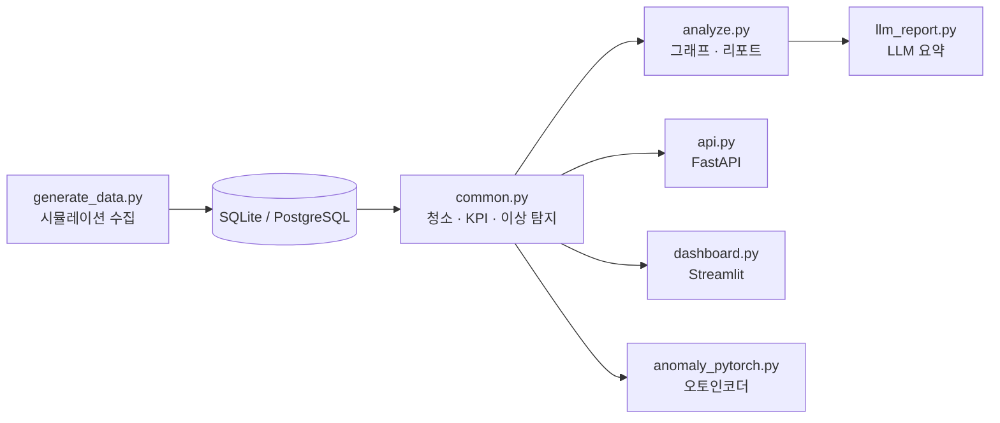
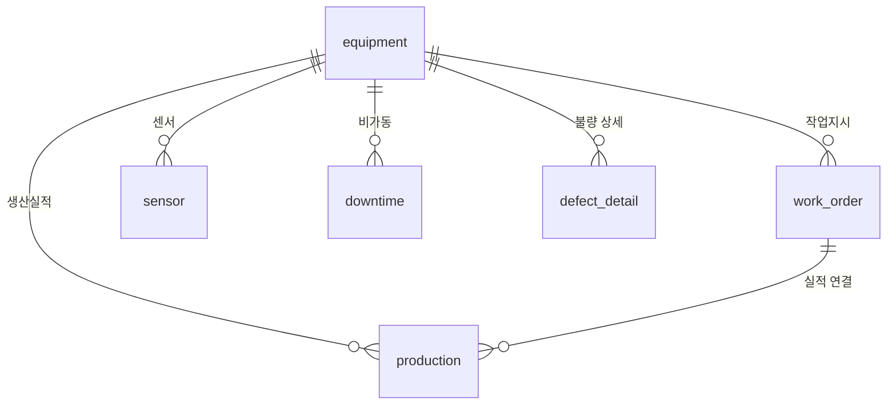
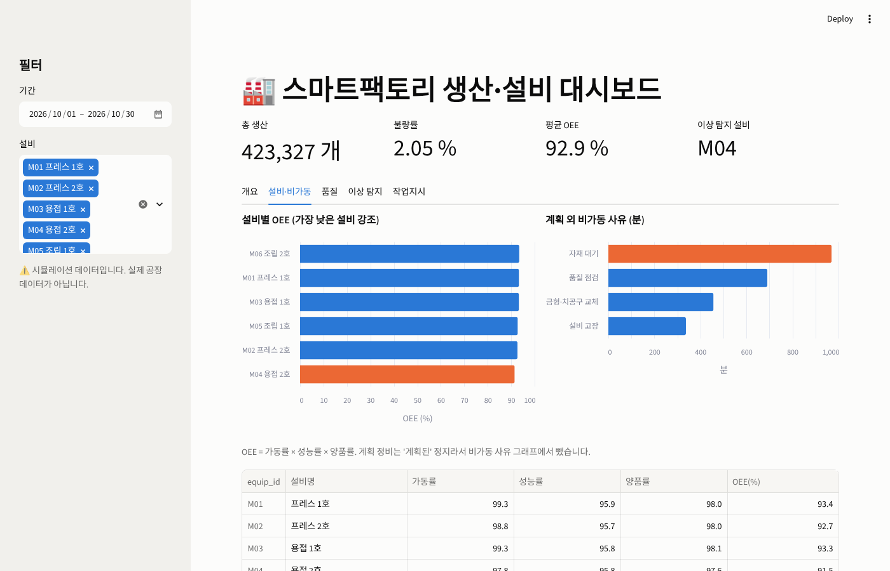
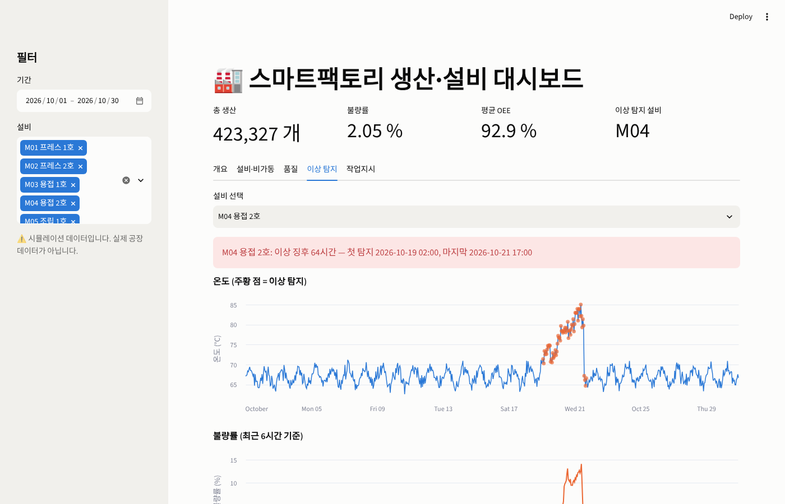
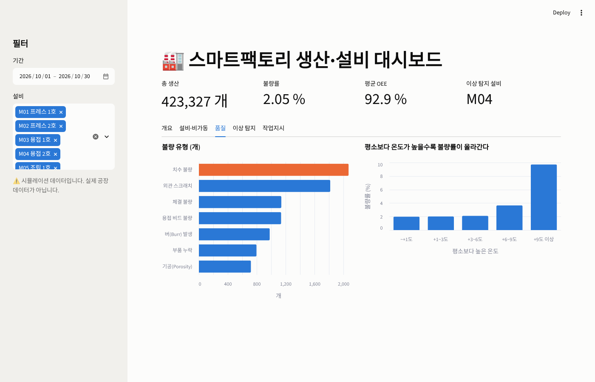
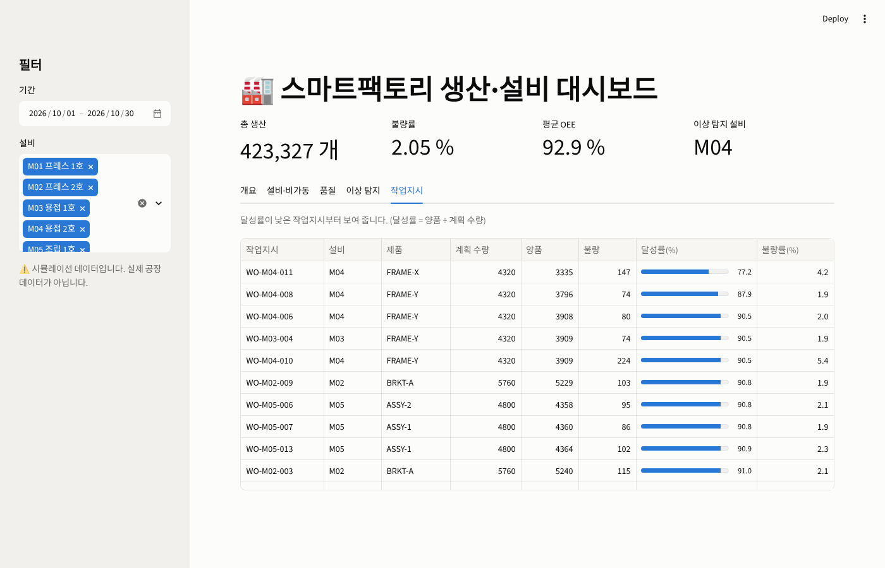

# 스마트팩토리 생산·설비 데이터 분석 플랫폼

MES(생산관리시스템)에 쌓이는 **작업지시·생산실적·센서·비가동·불량 데이터**를 DB에 저장하고,
KPI(OEE·불량률)와 파레토를 분석해 **불량이 늘기 전에 설비 이상을 먼저 잡아내는** 프로젝트입니다.
결과는 **웹 대시보드**와 **REST API**로 제공합니다.

> ⚠️ **데이터는 직접 만든 시뮬레이션입니다.** (`generate_data.py`)
> 실제 공장 데이터가 아니므로, 아래 수치는 "이 방법이 동작함"을 보여 주는 것이지 실제 공장의 성능이 아닙니다.



## 핵심 결과 (시뮬레이션 기준)

| 질문 | 결과 |
|---|---|
| 불량이 늘기 전에 이상을 잡을 수 있나? | M04 설비 온도 이상을 **불량률 5% 돌파보다 약 29시간 먼저** 탐지, 정상 설비 5대 **오탐 0건**, 센서가 2시간 튄 가짜 경보(M02)도 걸러냄 |
| 온도와 불량의 관계는? | 평소보다 6도 이상 뜨거워지면 불량률 2.0% → 3.7%(+6~9도) → **9.7%**(+9도 이상) |
| 어떤 불량이 문제인가? | M04는 **용접 비드 불량이 47%** — 과열 시 특정 유형이 급증 |
| 가장 큰 비가동 원인은? | **자재 대기 40%**(970분), 품질 점검 28%, 금형 교체 19%, 설비 고장 14% (계획 외 정지 기준) |
| 작업지시는 계획대로 됐나? | 달성률 최저 **WO-M04-011 77.2%** — 이상 구간·정비와 겹친 작업지시 |

## 구조



### 데이터 모델 (MES 구조를 단순화)



## 사용 기술 (실제로 한 것만 표시)

| 기술 | 어디에 썼나 |
|---|---|
| Python | 전체 코드 (pandas, matplotlib) |
| 데이터 수집·분석 | 수집 시뮬레이션, 데이터 청소(중복·오류값·빈 값), KPI·파레토 분석 |
| SQL·DB | SQLAlchemy 스키마(PK/FK), SQLite·**PostgreSQL 겸용**, SQL 조회 |
| 제조데이터·시스템 | 작업지시·생산실적·비가동 사유·불량 유형, OEE(가동률×성능률×양품률) |
| PyTorch | `anomaly_pytorch.py` 오토인코더 이상 탐지 |
| 생성형 AI·LLM | `llm_report.py` 분석 리포트를 보고 요약으로 변환 (Claude API) |
| API·백엔드 | FastAPI — KPI·OEE·파레토·작업지시·이상 탐지 7개 엔드포인트 |
| 대시보드 | Streamlit + Altair — 필터, KPI 카드, 탭 5개 |
| 테스트·CI | pytest 16개, GitHub Actions(SQLite 테스트 + PostgreSQL 연동) |
| Git·GitHub | 저장소 관리, Actions |
| Docker·Linux | `Dockerfile`, `docker-compose.yml` (db + init + api + dashboard) |
| (미사용) | OpenCV·YOLO, TensorFlow, Kubernetes, AWS·Azure·NCP |

## 화면

| 설비·비가동 | 이상 탐지 |
|---|---|
|  |  |

| 품질 | 작업지시 |
|---|---|
|  |  |

분석 스크립트가 만드는 그래프 6장은 `output/`에 있습니다. (일별 생산·불량률, OEE, 온도-불량, M04 타임라인, 비가동·불량 파레토)

## 실행 방법 (Windows, VS Code)

VS Code에서 폴더를 열고 **터미널 → 새 터미널**에서 한 줄씩 실행합니다.

```powershell
# 0) 이 프로젝트 전용 "작업 공간" 만들기 (처음 한 번)
python -m venv .venv
.venv\Scripts\activate

# 1) 도구 설치 (처음 한 번)
pip install -r requirements-dev.txt

# 2) 데이터 만들기 -> 분석 (output 폴더에 그래프·리포트 생성)
python generate_data.py
python analyze.py

# 3) 대시보드 켜기 (브라우저가 자동으로 열림, 끄려면 Ctrl + C)
streamlit run dashboard.py

# 4) API 서버 켜기 (http://127.0.0.1:8000/docs, 끄려면 Ctrl + C)
uvicorn api:app --reload

# 5) 테스트 실행
pytest -q
```

`.venv\Scripts\activate`에서 "스크립트 실행이 금지"라는 오류가 나면 한 번만 `Set-ExecutionPolicy -Scope CurrentUser RemoteSigned`를 입력하세요.

선택: PyTorch 이상 탐지와 LLM 요약 (설치 용량이 큼)

```powershell
pip install -r requirements-ml.txt
python anomaly_pytorch.py
python llm_report.py      # ANTHROPIC_API_KEY가 없으면 AI 없이 문장 틀로 요약
```

### Docker로 한 번에 실행 (Docker Desktop 필요)

```powershell
docker compose up --build
```

PostgreSQL → 데이터 생성·분석 → API(http://localhost:8000/docs) + 대시보드(http://localhost:8501)가 순서대로 켜집니다.

### PostgreSQL을 직접 연결하려면

```powershell
$env:DATABASE_URL = "postgresql+psycopg2://사용자:비밀번호@주소:5432/DB이름"
python generate_data.py
```

환경변수가 없으면 SQLite 파일(`data/factory.db`)을 씁니다.

## 이상 탐지: 두 방법 비교

| 방법 | M04 첫 이상 시각 | 정상 설비 오탐 | 특징 |
|---|---|---|---|
| 규칙 기반 (같은 시각대 평소 온도보다 6시간 평균 3도 초과) | 10/19 02:00 | 0건 | 단순하고 이유 설명이 쉬움 |
| PyTorch 오토인코더 (정상 데이터만 학습) | 10/19 12:00 | 0건 | 센서 3개를 함께 봄, 규칙보다 약 10시간 늦음 |

이 시뮬레이션에서는 단순한 규칙이 더 빨랐습니다. 센서 종류가 많고 관계가 복잡해지면 AI 방식이 유리해질 수 있습니다.

## 설계할 때 고려한 점

- **시각대별 비교**: 온도는 하루 주기로 변하므로 "같은 시각의 평소 값"과 비교해야 낮의 정상적인 상승을 이상으로 오인하지 않습니다.
- **6시간 평균**: 센서가 잠깐 튄 가짜 경보(M02)에 반응하지 않도록 평균을 사용합니다.
- **계획 정비는 비가동 파레토에서 제외**: 계획된 정지는 개선 대상이 아니기 때문입니다.
- **DB 호환**: SQLite는 참/거짓을 1/0으로 돌려주고 PostgreSQL은 bool로 돌려주므로 읽을 때 통일합니다. 스키마는 SQLAlchemy 한 곳에서 정의합니다.
- **오토인코더 활성화 함수**: ReLU는 평소 범위를 크게 벗어난 값도 선형으로 잘 복원해 이상을 놓쳤고, Tanh로 바꿔 출력 범위를 제한하자 탐지됐습니다.
- **청소 로직 분리**: `clean_data()`는 DB 없이 표만 받아 동작하는 함수라서 단위 테스트가 쉽습니다.

## 한계와 다음 단계

- 시뮬레이션 데이터입니다. 공개 설비 데이터(Kaggle, UCI SECOM 등)로 바꿔 검증하는 것이 다음 단계입니다.
- 센서 데이터를 파일/DB에서 읽는 배치 구조입니다. 실제 설비 연동(MQTT, OPC-UA)과 실시간 처리는 다루지 않았습니다.
- 인증·권한(로그인)이 없습니다. 클라우드 배포(AWS 등)와 Kubernetes는 다루지 않았습니다.
- 이상 탐지 임계값(3°C)은 이 시뮬레이션에 맞춘 값입니다. 실제 적용 시 설비별로 조정해야 합니다.

## 폴더 구조

```
├─ generate_data.py     데이터 생성·DB 적재 (시뮬레이션 수집)
├─ db.py                DB 연결, 테이블 스키마 (SQLAlchemy)
├─ common.py            데이터 청소, KPI·파레토 계산, 규칙 기반 이상 탐지
├─ analyze.py           분석 + 그래프 6장 + report.md
├─ dashboard.py         Streamlit 대시보드
├─ api.py               FastAPI 서버
├─ anomaly_pytorch.py   PyTorch 오토인코더 이상 탐지
├─ llm_report.py        LLM 일일 요약
├─ tests/               pytest (계산·API·대시보드)
├─ .github/workflows/   GitHub Actions CI
├─ Dockerfile, docker-compose.yml
├─ docs/                대시보드 화면 캡처
└─ output/              분석 그래프·리포트
```

## GitHub에 올리기

```powershell
git init
git add .
git commit -m "스마트팩토리 데이터 분석 플랫폼"
git branch -M main
git remote add origin https://github.com/kwarks72/smart-factory-analytics.git
git push -u origin main
```

먼저 GitHub에서 `smart-factory-analytics` 이름의 빈 저장소를 만들어 두세요. 올리면 Actions 탭에서 테스트가 자동으로 돕니다.
